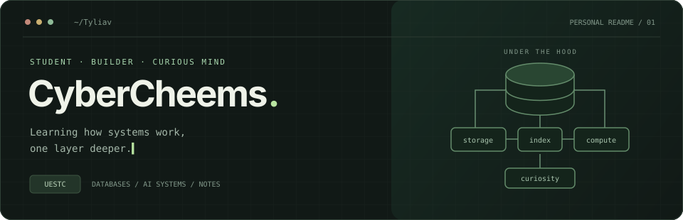

  

  <a href="https://cybercheems.top"><strong>技术博客 ↗</strong></a>
  &nbsp;&nbsp; / &nbsp;&nbsp;
  <a href="https://github.com/Tyliav?tab=repositories">代码仓库 ↗</a>
  &nbsp;&nbsp; / &nbsp;&nbsp;
  <a href="mailto:1939523795@qq.com">联系我 ↗</a>

 

### 01 / Hello, world

我是 **Luboxu**，也可以叫我 **CyberCheems**，一名来自 **UESTC · 电子科技大学** 的学生。

对系统底层如何运转保持好奇，正在学习数据库系统，也关注大模型系统、Serverless 与性能工程。我喜欢把读到的原理写成代码，再把实践中的问题整理成笔记。

> 从一个能跑的实现开始，慢慢理解它为什么这样工作。

 

### 02 / Exploring

| 方向 | 我感兴趣的问题 |
| :--- | :--- |
| **Database Systems** | 数据如何存储、索引和执行？探索 Buffer Pool、B+ Tree、查询处理与并发控制。 |
| **LLM Systems** | 大模型如何高效运行？关注推理、KV Cache 和系统层面的性能问题。 |
| **Distributed & Serverless** | 服务如何协作、扩展和恢复？学习分布式系统与云端应用。 |
| **Learning in Public** | 将课程、阅读和项目实践整理成可以复用的技术笔记。 |

 

### 03 / On my workbench

<table>
  <tr>
    <td width="50%" valign="top">
      <h3>↗ CyberCheems Blog</h3>
      
记录数据库、大模型系统、Serverless 与性能工程的学习笔记和项目实践。写给未来的自己，也写给正在阅读的人。

      
<code>Next.js</code> <code>TypeScript</code> <code>Markdown</code>

      
<a href="https://cybercheems.top">阅读博客 →</a> &nbsp; <a href="https://github.com/Tyliav/blog">查看代码 →</a>

    </td>
    <td width="50%" valign="top">
      <h3>↗ Database Learning</h3>
      
围绕 BusTub 与数据库课程学习系统实现，从存储管理、索引到查询执行，逐步建立对数据库内部的理解。

      
<code>C++</code> <code>BusTub</code> <code>Database</code>

      
<a href="https://github.com/Tyliav/bustub">BusTub 仓库 →</a> &nbsp; <a href="https://github.com/Tyliav/training-plan-2026">学习路线 →</a>

    </td>
  </tr>
</table>

 

### 04 / Tools along the way

学习与项目中接触的语言、工具和框架：

  
  
  
  
  
  

 

---

  保持好奇，认真构建。 / Stay curious. Build with care.

